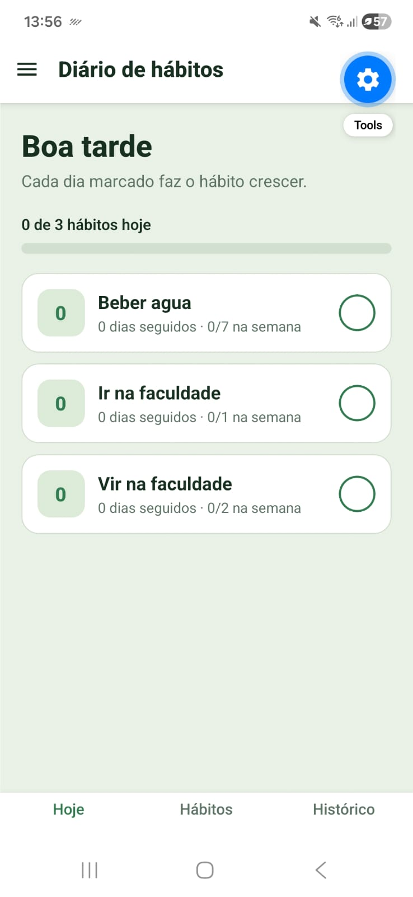
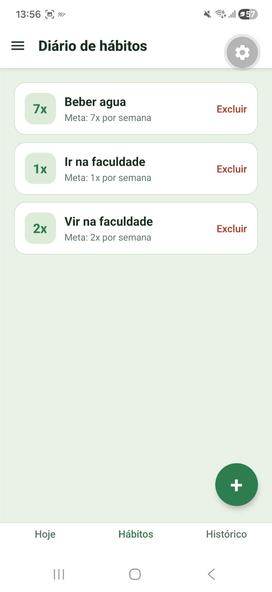
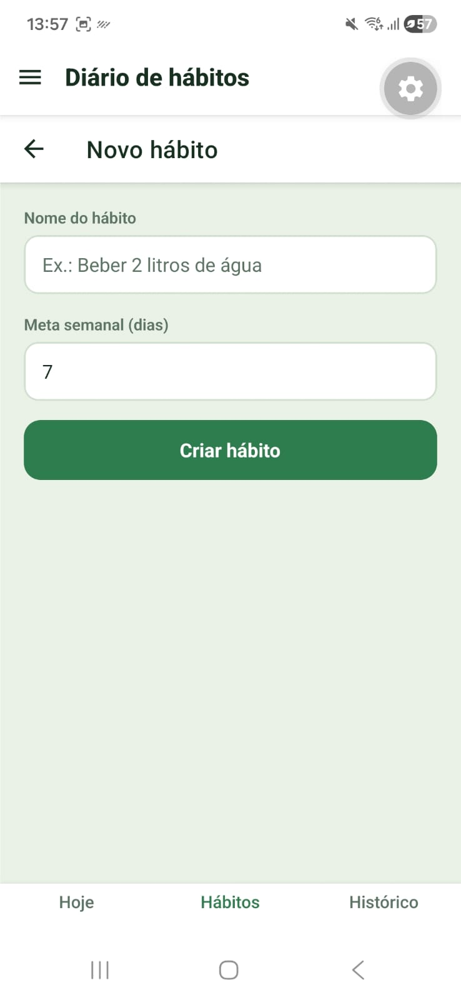
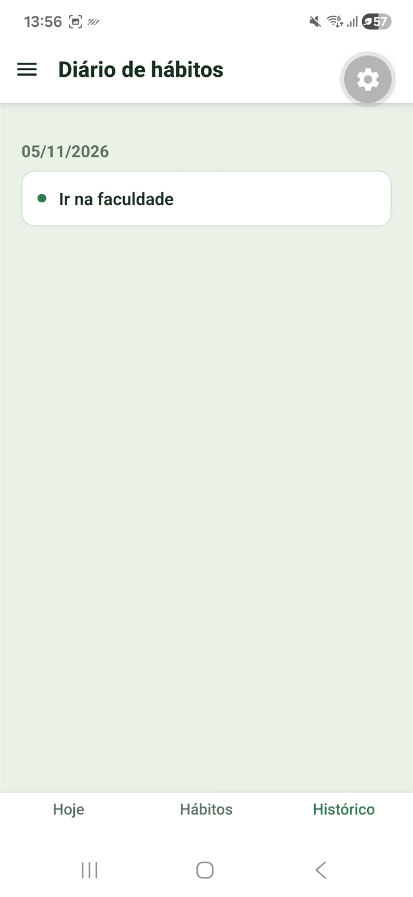
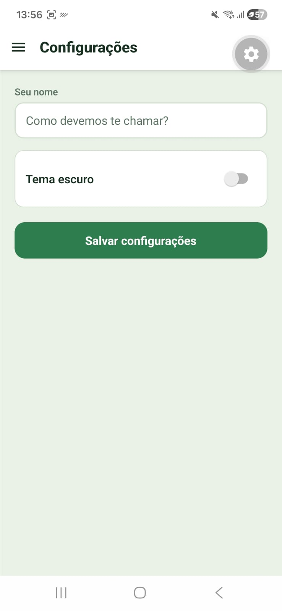
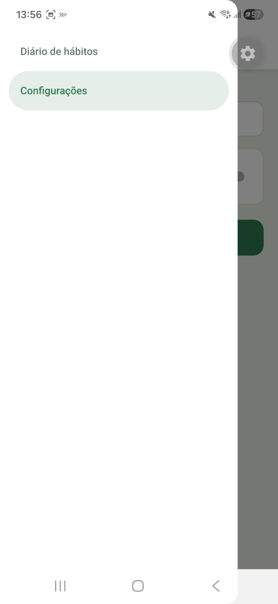

# Hábito em Dia

Aplicativo móvel de **diário de hábitos** desenvolvido com **React Native e Expo**.

O usuário cadastra hábitos (beber água, estudar, caminhar...), marca dia a dia se os cumpriu e acompanha a **sequência de dias seguidos** de cada um. Os dados ficam salvos no aparelho e continuam disponíveis depois de fechar o app.

> Trabalho da disciplina **Programação para Dispositivos Móveis (PDM)** · 4º semestre
> Tecnologia em Sistemas para Internet · IMES Catanduva
> Professor: Prof. Esp. Thales Emanuel Figueiredo
> Tema: **Diário de hábitos**

---

## Integrantes

| Nome |
|---|---|
| Vinicyus Raya |
| Braian Elizeu |
| Mariana Miguel |

---

## Funcionalidades

- **Cadastro de hábitos** com nome e meta semanal (1 a 7 dias), com opção de editar e excluir.
- **Marcação diária:** um hábito só pode ser marcado **uma vez por dia**.
- **Sequência atual** de dias seguidos exibida em cada hábito. A sequência continua ativa se o dia de hoje ainda não foi marcado, e só é quebrada quando ontem também fica sem registro.
- **Progresso do dia** com a quantidade de hábitos concluídos.
- **Histórico** dos registros agrupados por data.
- **Configurações:** nome do usuário e tema claro/escuro, salvos no aparelho.
- Validação dos campos com mensagens de erro e avisos de lista vazia.

---

## Telas

| Tela | Descrição |
|---|---|
| **Hoje** | Hábitos do dia com marcação, saudação com o nome do usuário e progresso |
| **Hábitos** | Lista de hábitos com criar, editar e excluir |
| **Novo/Editar hábito** | Formulário com validação (recebe o `habitoId` por parâmetro quando é edição) |
| **Histórico** | Registros agrupados por data |
| **Configurações** | Nome do usuário e tema |

### Prints

> Adicione as imagens na pasta `docs/prints/` e confira se os nomes abaixo batem com os dos arquivos.

| Hoje | Hábitos |
|---|---|
|  |  |

| Novo hábito | Histórico |
|---|---|
|  |  |

| Configurações | Menu lateral |
|---|---|
|  |  |

---

## Tecnologias

- [React Native](https://reactnative.dev/) com [Expo](https://expo.dev/)
- [React Navigation](https://reactnavigation.org/): Stack, Bottom Tabs e Drawer
- [expo-sqlite](https://docs.expo.dev/versions/latest/sdk/sqlite/): banco de dados local
- [AsyncStorage](https://react-native-async-storage.github.io/async-storage/): preferências do usuário

---

## Navegação

```
Drawer
├─ Principal (Tab)
│   ├─ Hoje
│   ├─ Hábitos (Stack)
│   │   ├─ Lista de hábitos
│   │   └─ Novo/Editar hábito   ← recebe { habitoId }
│   └─ Histórico
└─ Configurações
```

---

## Banco de dados (SQLite)

```sql
CREATE TABLE habito (
  id INTEGER PRIMARY KEY AUTOINCREMENT,
  nome TEXT NOT NULL,
  meta_semanal INTEGER NOT NULL
);

CREATE TABLE registro (
  id INTEGER PRIMARY KEY AUTOINCREMENT,
  habito_id INTEGER NOT NULL,
  data TEXT NOT NULL,                -- formato AAAA-MM-DD
  FOREIGN KEY (habito_id) REFERENCES habito(id) ON DELETE CASCADE,
  UNIQUE (habito_id, data)           -- impede marcar duas vezes no mesmo dia
);
```

- As tabelas se ligam por `habito_id`.
- Ao excluir um hábito, os registros dele são excluídos junto (`ON DELETE CASCADE`).
- **CRUD:** criar, listar, alterar e excluir hábitos; marcar e desmarcar registros.

### AsyncStorage

| Chave | Conteúdo |
|---|---|
| `nome` | Nome do usuário, exibido na saudação |
| `escuro` | Preferência de tema (claro/escuro) |

> Se as chaves do seu código tiverem outros nomes, atualize a tabela acima.

---

## Estrutura do projeto

```
├─ App.js
└─ src/
   ├─ navigation/
   │   └─ AppNavigator.js
   ├─ screens/
   │   ├─ HojeScreen.js
   │   ├─ HabitosScreen.js
   │   ├─ FormHabitoScreen.js
   │   ├─ HistoricoScreen.js
   │   └─ ConfigScreen.js
   ├─ components/
   │   ├─ Botao.js
   │   ├─ CampoTexto.js
   │   ├─ HabitCard.js
   │   └─ EmptyState.js
   └─ database/
       ├─ db.js
       ├─ habitoRepository.js
       └─ registroRepository.js
```

---

## Como instalar

**Pré-requisitos**

- [Node.js](https://nodejs.org/) (versão LTS)
- [Git](https://git-scm.com/)
- App **Expo Go** no celular (Android ou iOS) ou um emulador configurado

**Passos**

1. Clone o repositório:

   ```bash
   git clone https://github.com/SEU-USUARIO/NOME-DO-REPOSITORIO.git
   ```

2. Entre na pasta do projeto:

   ```bash
   cd NOME-DO-REPOSITORIO
   ```

3. Instale as dependências:

   ```bash
   npm install
   ```

> Se o `npm install` não instalar tudo corretamente, rode os comandos abaixo, cada um em uma linha:
>
> ```bash
> npx expo install expo-sqlite @react-native-async-storage/async-storage react-native-screens react-native-safe-area-context react-native-gesture-handler react-native-reanimated react-native-worklets
> ```
>
> ```bash
> npm install @react-navigation/native @react-navigation/native-stack @react-navigation/bottom-tabs @react-navigation/drawer
> ```

---

## Como executar

1. Inicie o servidor de desenvolvimento:

   ```bash
   npx expo start
   ```

2. Abra o app:
   - **No celular:** abra o **Expo Go** e escaneie o QR code mostrado no terminal. O celular e o computador devem estar na **mesma rede Wi-Fi**.
   - **No emulador Android:** com o emulador aberto, pressione `a` no terminal.
   - **No simulador iOS (macOS):** pressione `i` no terminal.

**Problemas comuns**

| Problema | Solução |
|---|---|
| O celular não conecta | Rode `npx expo start --tunnel` |
| Erro estranho depois de instalar pacotes | Pare o servidor (`Ctrl + C`) e rode `npx expo start -c` para limpar o cache |
| Dados antigos atrapalhando os testes | Desinstale o app do celular ou limpe os dados do Expo Go |

---


